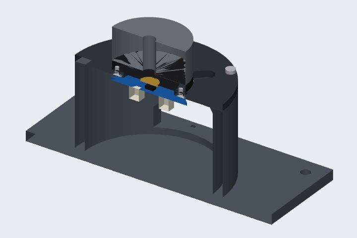
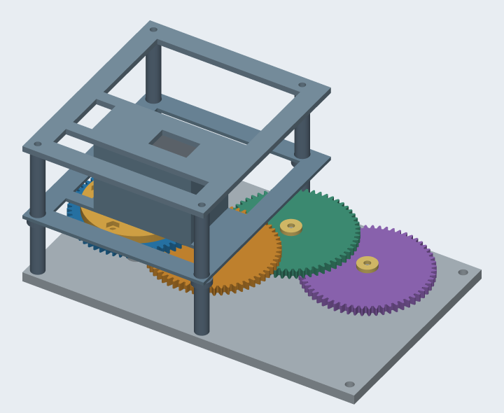
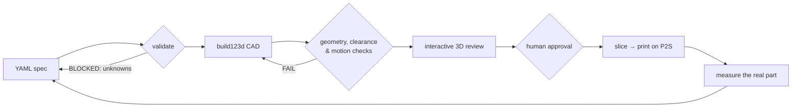
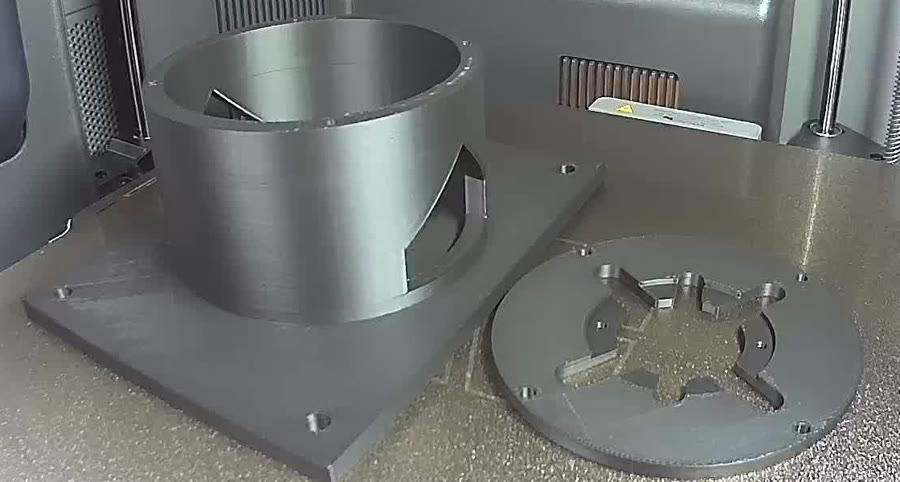
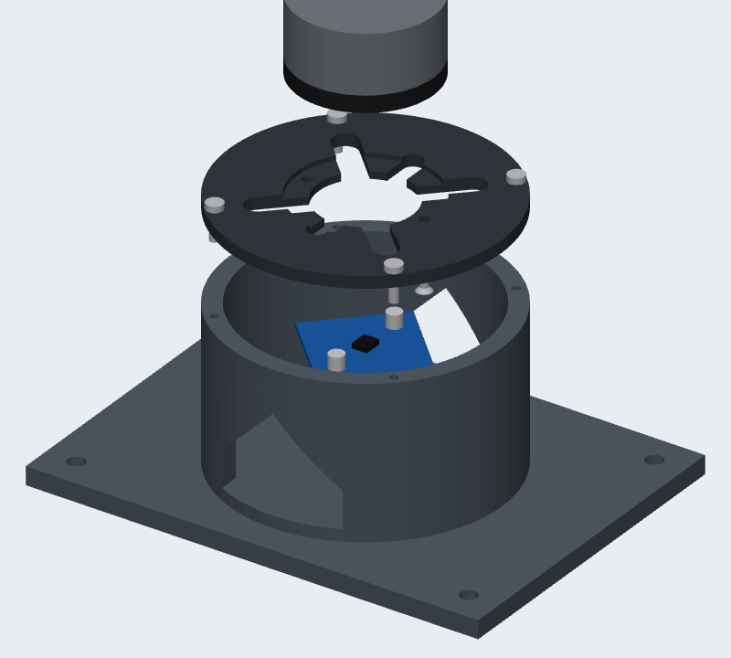
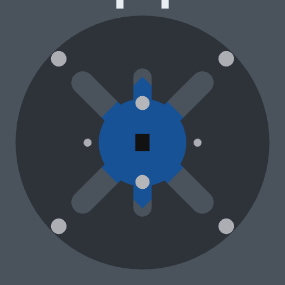
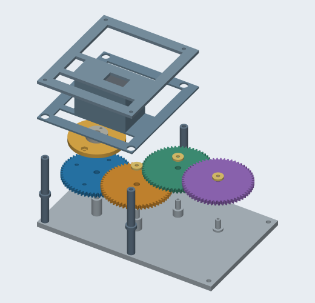
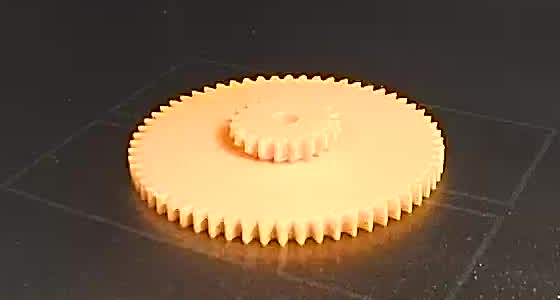

# print-in-the-loop

**Agent-driven parametric CAD for 3D printing.** A human and an AI coding agent design
mechanical parts as Python, prove them with automated geometry checks, review them in an
interactive 3D page, then slice and print them on a Bambu Lab P2S. Measurements from the
real parts go back into the specs.

<p align="center">
  
  
</p>



Every step reports **PASS / FAIL / BLOCKED**. Unknown engineering values stay unknown instead
of being guessed, and nothing gets printed without the human saying so.

## What's been built

### Face-up BLDC motor evaluation stand · *printed*

<p align="center"></p>

<p align="center">
  
  
</p>

A desktop holder for developing a motor driver and FOC control loop with a 4015 hollow-shaft
gimbal motor (24N22P, 11 pole pairs).

- **The encoder board stays swappable.** The motor's two hole circles lie on the same four
  axes, 5.5 mm apart, so a stand screw and an encoder standoff can't share an axis. The
  stand uses one opposite pair of holes and the encoder the other. Below the motor is an
  open Ø78 × 50 mm cavity for any board up to 53 mm square, on standoffs from 3 to 8 mm.
  It fits both the supplied MT6701 board and a retrofitted 33 mm AS5600.
- **Two printed parts.** A motor-specific plate (Ø90 × 4 mm) sits on a common tower and
  base (150 × 110 × 56 mm), so supporting another motor means printing a new plate.
- **84 automated checks.** Keep-outs for the rotating bell and boss, an encoder envelope
  swept across the standoff range, standoff passage through the slots, motor seat and
  tower support, screw engagement against the 3 mm thread depth, window/base integrity,
  STEP round trips and manifold STLs.
- Prints without supports: 2 h 16 min, ~100 g PLA.

[Design notes and assembly →](docs/bldc_4015_stand_proposal.md)

### 27:1 compound gearbox · *CAD complete*

<p align="center"></p>

Four 60T/20T module-1 compound gears on plastic shafts printed with the back plate,
driven by a Waveshare ST3215 servo through its metal horn. Three meshes give −1/27.
15 printable parts, 174 × 109 × 75.9 mm. Checks include involute mesh profiles, tooth-phase
sampling over a full tooth period (contact ratio 1.67), full-revolution moving envelopes and
static interference. The vendor servo STEP contained an invalid solid, so the assembly uses
dimensioned reference envelopes, and the limitation is documented rather than hidden.

[Assembly guide and BOM →](docs/gearbox_build_and_assembly.md) · [Design decision D003 →](decisions/0003-gearbox-trial.md)

### First print · *one gear, October 2026*

<p align="center"></p>

A test gear printed large-face-down so the 60T teeth need no support. Getting there turned
up two traps worth knowing if you script Bambu Studio:

- **The CLI does not resolve system presets.** Passing stock P2S profiles directly produced
  G-code with a generic `G28` start: no AMS filament load, no bed leveling. It would have
  printed air. Flatten each preset's `inherits` chain and `include` templates first.
- **The P2S wants the H2-style `project_file` command over LAN.** It needs a `ftp:///cache/<file>`
  URL and non-zero task IDs. The older P1/X1 form fails with `0500-4002 Unsupported file path or name`.

[Full print record →](docs/first_print_gear2.md)

### Rotor indicator disc · *on hold*

An orange disc with flush black inlaid markers at 0/90/180/270° (circle, triangle, square,
cross) for eyeballing position-control tests. Designed and checked as a two-color print;
waiting on a second motor type so one disc can fit both.

## How the checks work

Each design type has its own builder in `src/mech_lab/` and its own independent checks:

| Check | What it proves |
|---|---|
| Valid single solids | The CAD kernel considers every printed part a closed, valid solid |
| Envelope and placement | Dimensions, origin and marker/hole positions match the spec, not the CAD code's intent |
| Interference and keep-outs | Zero overlap with moving parts, purchased-part envelopes and swept ranges |
| Motion | Tooth clearance across sampled mesh phases; full-revolution swept volumes |
| Export round trip | STEP reopens with identical volume and bounds; STL is edge-manifold and grounded |
| Seeded defects | Tests break the geometry on purpose (shifted marker, thick floor, notched base…) and require the matching check to fail |

Software tolerances (1e-6 mm, 1e-8 relative volume) prove the model is self-consistent.
They are **not** print tolerances. Printed fit is only established by measuring real parts.
Changing an acceptance threshold to make a design pass is against the rules here. When the
stand's arched windows failed the STEP round trip by 3.6e-8, the window shape changed
instead.

## Quick start

Requires Python 3.12. Commissioned on native arm64 macOS; other platforms are untested.

```bash
python3.12 -m venv .tools/uv
.tools/uv/bin/python -m pip install --disable-pip-version-check --no-cache-dir uv==0.12.10
.tools/uv/bin/uv sync --locked
.tools/uv/bin/uv run --locked pytest -q          # 75 tests, about a minute
```

If `uv` is already installed, use it in place of `.tools/uv/bin/uv`. Build a design into a
new directory, then open its interactive review:

```bash
uv run --locked build_design specs/bldc_4015_stand_v1.yaml --output builds/my-stand
open builds/my-stand/review.html                  # orbit, cutaway, explode, spin the rotor

uv run --locked build_design specs/gearbox_v1.yaml --output builds/my-gearbox --timeout 600
open builds/my-gearbox/review.html                # animated 27:1 gear train + BOM
```

The gearbox build needs Waveshare's ST3215 STEP, which isn't redistributed here. Download it
from the source listed in [components/drawings/README.md](components/drawings/README.md); the
build verifies its SHA-256. Without it, the one test that needs it is skipped.

Each build writes `parts/*.step`, print-oriented `print/*.stl`, `assembly.step`,
`geometry_report.json` and a `build_manifest.json` that records source, dependency and
artifact hashes. `builds/` is git-ignored; everything in it can be regenerated.

## Tools

Every command emits JSON plus a short summary. Exit codes: **0 PASS · 1 FAIL · 2 BLOCKED**.

| Command | Scope |
|---|---|
| `validate_spec SPEC [--scope schema\|build\|release]` | Strict schema, explicit unknowns, readiness. Release is always BLOCKED. |
| `build_design SPEC --output DIR` | Smoke block, cube/sphere, compound gearbox, indicator disc, BLDC stand |
| `inspect_geometry STEP --spec SPEC` | Independent re-inspection of an exported assembly (smoke, cube/sphere, gearbox; the stand and disc check inside their builders) |
| `render_review MANIFEST --output DIR` | Hash-checked SVG projections (isometric, top, front, right) |
| `environment_report` | Python/package versions and desktop app inventory |

Specs reject unknown fields, duplicate YAML keys, missing units, infeasible geometry and
inconsistent approval metadata. `specs/finger_joint_v1.yaml` deliberately returns BLOCKED
to show that unresolved inputs stop a build rather than getting invented.

## Repository layout

```
cad/           authoritative parts and assemblies (Python, build123d)
specs/         validated YAML design inputs
src/mech_lab/  schema, CLI, builders, checks, review generators
tests/         rebuilds, seeded defects, schema rejections
components/    purchased-part registry and provenance
measurements/  user-reported and measured values; never overwritten
decisions/     design decision records
docs/          status, proposals, assembly guides, print records
validation/    software geometry policy
```

[`docs/status.md`](docs/status.md) is the running record of what has actually been verified.
[`AGENTS.md`](AGENTS.md) holds the operating rules the AI agent follows: keep assumptions
proposed until approved, never invent component facts or calibrations, preserve
measurements, and treat a development build as no authorization to print.

## Status and limits

- Motor, servo and encoder geometry comes from supplier drawings plus reported
  measurements. Physical fit is confirmed only by printing and measuring.
- No load ratings, no powered tests, no releases. Release packaging reports BLOCKED by design.
- Prints so far were sent with one-off LAN scripts (status reads, FTPS upload, start command),
  each approved by the human beforehand. No printer-control tool lives in this repo.

## License

Free for personal, educational, research and other noncommercial use.

- **Software** (code, CAD scripts, specs, tests, tools): [PolyForm Noncommercial 1.0.0](LICENSE)
- **Documentation, images and designs**: [CC BY-NC-SA 4.0](LICENSE-docs)

**Commercial use requires written permission.** Contact [@analogjedi](https://github.com/analogjedi).
Third-party supplier drawings and CAD are not included, and neither license covers them.

## Built with

[build123d](https://github.com/gumyr/build123d) on the OpenCascade kernel ·
[uv](https://docs.astral.sh/uv/) · [Pydantic](https://docs.pydantic.dev/) ·
[Bambu Studio](https://github.com/bambulab/BambuStudio) CLI ·
[OCP CAD Viewer](https://github.com/bernhard-42/vscode-ocp-cad-viewer) ·
designed in collaboration with AI coding agents.
